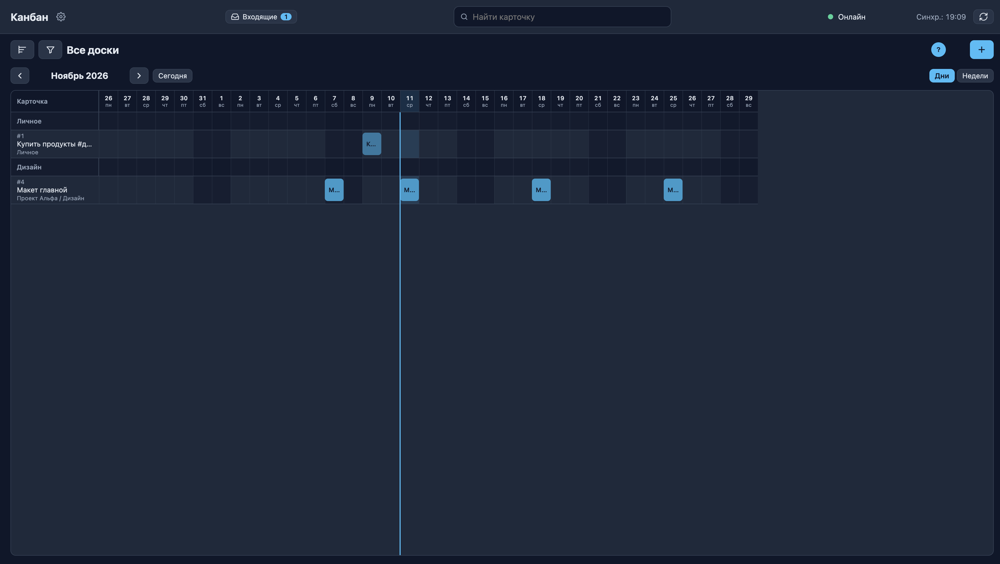
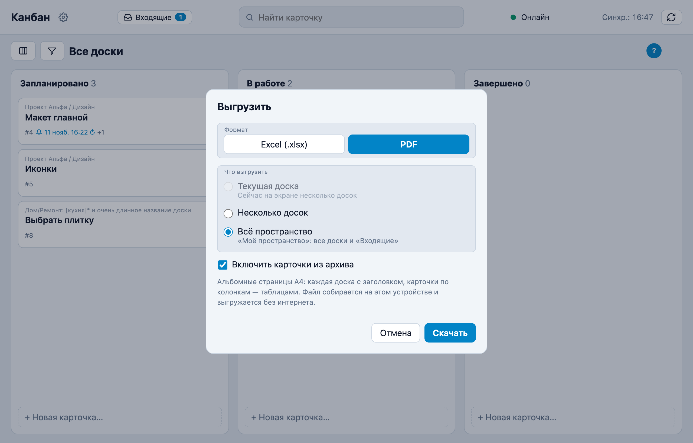
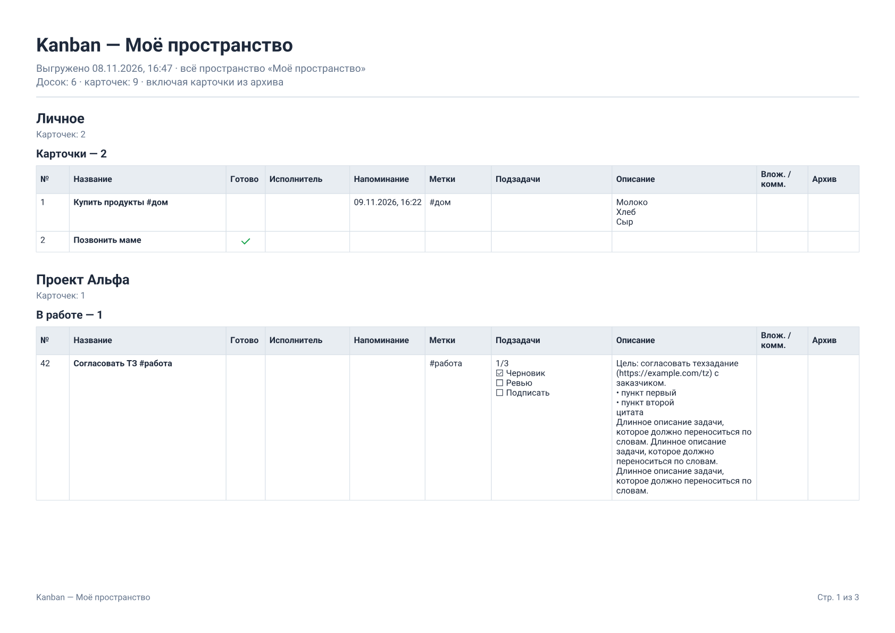
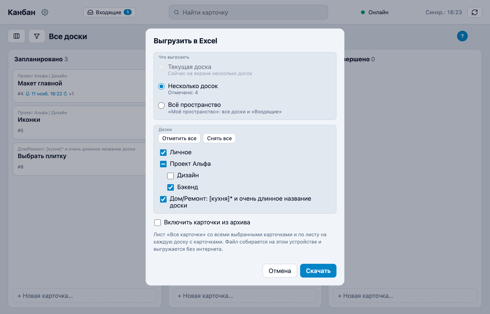
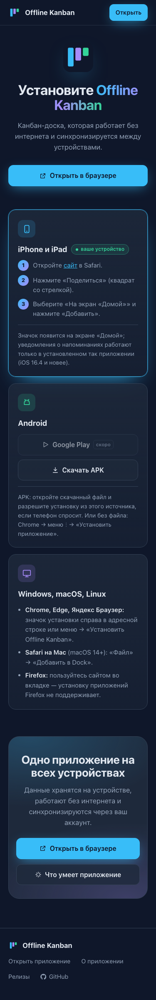
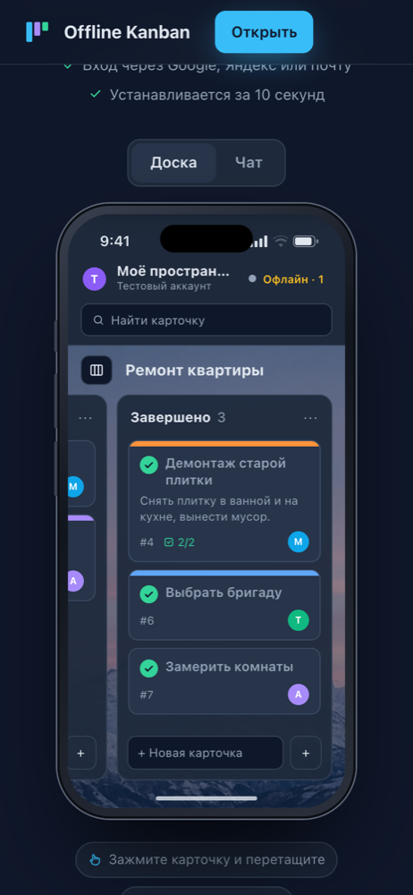
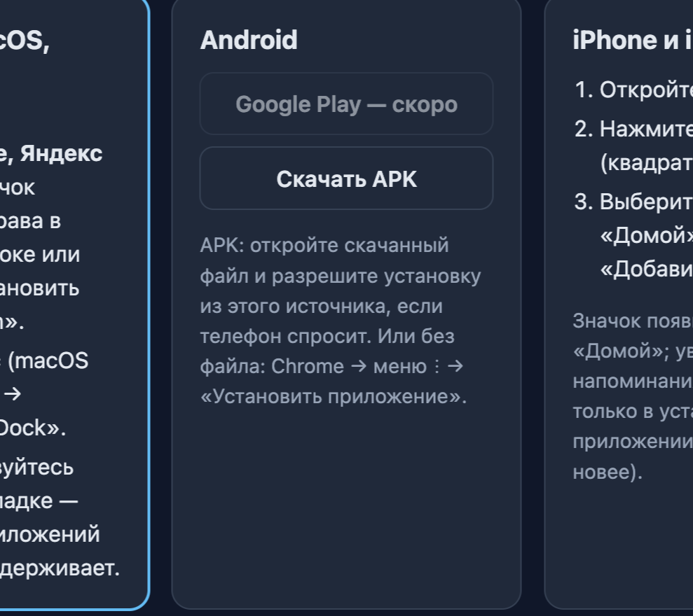

# История изменений

Каждое изменение записывается сюда вместе с коммитом: дата, что изменилось для пользователя и, если нужно,
скриншот (`docs/screenshots/`). Новые записи — сверху.

## 2026-11-13

**Зависимости задач**
- В карточке можно указать, какие другие карточки должны быть выполнены раньше.
  Пока они не готовы, задачу нельзя перенести из первой колонки, в последнюю или отметить выполненной;
  на доске у такой карточки значок «Ждёт».

**Календарь**
- На ячейке дня (и в списке дней на телефоне) кнопка «+»: открывается новая карточка с напоминанием
  на этот день в 9:00.
- В списке на телефоне текущий день выделен: подпись «Сегодня», цветной кружок с числом, фон блока;
  при открытии месяца список прокручивается к сегодняшнему дню.

**Фильтр досок**
- Если в пространстве одна доска, в заголовке и фильтре показывается её название, а не «Все доски»; переключатель
  «Показывать все доски» скрыт — остаётся включение и выключение самой доски.

**Релизы и «Что нового»**
- История обновлений дублируется на отдельной странице [/releases.html](/releases.html) (из CHANGELOG при каждой
  сборке) и в [GitHub Releases](https://github.com/ravler1704/kanban-pwa/releases) (тег `web-YYYY-MM-DD`).
- Ссылки «Что нового» на промо-странице и на странице установки.

**Фильтры доски**
- Исправлено пустое отображение доски, если в фильтрах был выбран другой набор колонок (например «Фильмы»),
  а в виду осталась одна доска с своим набором (например «Канун»): теперь подставляется набор этой доски.

## 2026-11-11

**Фильтр по цвету карточки**
- В окне «Фильтры» появился пункт «Цвет»: можно оставить карточки с выбранными полосками сверху
  (и «Без цвета», если нужно). Отмечайте несколько цветов сразу — показываются карточки с любым из них.
  Выбор запоминается на устройстве и действует во всех видах доски.

**Яндекс.Браузер**
- Снова плавно сдвигается название карточки, когда при наведении появляется кружок «выполнено».
- Пунктирное подчёркивание у переименовываемого названия доски (и других таких полей) видно только
  при наведении или при фокусе с клавиатуры, а не постоянно.

**Диаграмма Ганта**
- В переключателе вида доски появился «Гант»: карточки с напоминаниями — полоски на шкале времени. Можно смотреть
  дни или недели, листать даты и вернуться к сегодня. Полоски сгруппированы по доскам, цвет — как у карточки или
  колонки. Перетащите полоску, чтобы перенести напоминания на другой день; нажмите — откроется карточка.
- Исправлено перетаскивание полоски: после отпускания мыши она больше не «убегает» за курсором.
- Строки на диаграмме больше не меняются местами при переносе напоминания: порядок карточек
  как на доске, а не по дате напоминания.

## 2026-11-08

**Выгрузка в PDF**
- Пункт меню доски теперь называется «Выгрузить в Excel / PDF…»: в окне выгрузки появился выбор формата —
  «Excel (.xlsx)» или «PDF». Выбранный формат запоминается на устройстве. Что выгружать — как раньше: текущая
  доска, несколько досок или всё пространство, по желанию с карточками из архива.
- PDF — альбомные страницы A4 для чтения и печати: заголовок «Kanban — доска или пространство», дата выгрузки и
  что выбрано; затем каждая доска с полным путём, её колонки с числом карточек и таблицы карточек: номер,
  название, выполнена (✓), исполнитель, ближайшее напоминание, метки, подзадачи («1/3» и список с ☑/☐), описание
  (без разметки), число вложений и комментариев, отметка архива. Длинный текст переносится, таблица продолжается
  на следующей странице с повтором шапки, внизу — «Стр. N из M». Русский текст в PDF можно выделять и искать.
- PDF, как и Excel, собирается прямо на устройстве и работает без интернета. Файл называется
  «Kanban — доска или пространство — дата.pdf».
- На [промо-странице](https://178-83-123-195.sslip.io/promo) и в README — «Выгрузка в Excel и PDF».

**Выгрузка в Excel**
- В меню доски («⋯» справа или правый клик по пустому месту доски) — «Выгрузить в Excel…». Можно выгрузить
  текущую доску (вместе с вложенными досками на экране), несколько досок — отметить их в дереве (отметка доски
  отмечает и всё внутри неё), или всё пространство вместе с «Входящими». По желанию — с карточками из архива.
- В файле — лист «Все карточки»: номер, доска (полный путь), колонка, название, описание, метки, выполнена,
  исполнитель, автор, ближайшее напоминание (настоящей датой Excel) и все напоминания, подзадачи («1/3» и список),
  вложения, число комментариев, дата изменения; при нескольких досках — ещё по листу на каждую доску.
  Заголовок закреплён, есть автофильтр. Файл называется «Kanban — доска или пространство — дата.xlsx».
- Файл собирается прямо на устройстве, поэтому выгрузка работает и без интернета.
- Выгрузка добавлена в возможности на [промо-странице](https://178-83-123-195.sslip.io/promo) и в README.

**Страница установки в стиле промо-страницы**
- [«Установить приложение»](https://178-83-123-195.sslip.io/install.html) теперь выглядит как часть
  промо-страницы: та же шапка с разделами и кнопкой «Открыть», крупный заголовок, карточки Android, iPhone и iPad,
  Windows/macOS/Linux рядом (ваше устройство — первым, с отметкой), шаги для iPhone пронумерованы, внизу — кнопки
  «Открыть в браузере» и «Что умеет приложение» и общий подвал. Инструкции и ссылка на APK не изменились.

**Промо-страница: установка на Mac**
- В ответах на частые вопросы — как установить приложение на Mac через Safari («Файл» → «Добавить в Dock»);
  страница подключает манифест приложения.

**Промо-страница по короткому адресу**
- [/promo](https://178-83-123-195.sslip.io/promo) открывает промо-страницу без входа в аккаунт (раньше там
  показывалось приложение с экраном входа).

**Промо-страница**
- Новая страница [«Offline Kanban»](https://178-83-123-195.sslip.io/promo.html) — знакомство с приложением: живая
  демо-доска на компьютере и iPhone (карточки можно перетаскивать и отмечать, подзадачи — ставить галочками,
  в чате — писать сообщения с галочками «доставлено»/«прочитано», можно «выключить интернет» и посмотреть, как
  изменения ждут сети и потом синхронизируются, приходит напоминание). Ничего из демо не сохраняется.
- На странице — возможности, платформы, настоящие скриншоты, «три шага», частые вопросы и кнопки «Открыть в
  браузере», «Установить», «Скачать APK». Ссылки на неё — в README и на странице установки.

**Установка на любые устройства**
- Страница [«Установить приложение»](https://178-83-123-195.sslip.io/install.html): Android (APK, скоро Google
  Play), iPhone и iPad, Windows, macOS и Linux; своё устройство определяется и показывается первым, в Chrome и Edge
  есть кнопка «Установить на это устройство». Ссылка на неё — на экране входа.
- Приложение для Android: [APK](https://178-83-123-195.sslip.io/downloads/offline-kanban.apk)
  (Android 7.0+) открывает доску на весь экран, без адресной строки; уведомления о напоминаниях приходят как от
  обычного приложения. Готова сборка для Google Play.
- В README вместо адреса — кнопки «Открыть демо», «Скачать APK», Google Play, iPhone и iPad, компьютер.
- В окне «Аккаунт» новая вкладка «Приложение»: установка на это устройство и подсказка для вашей платформы.
- Иконки для Android и iOS (в том числе адаптивная), скриншоты и описание в манифесте — браузеры показывают
  расширенное окно установки.

- Проект опубликован на GitHub: описание и скриншоты в README, эта история изменений.
- В README добавлена ссылка на демо: https://178-83-123-195.sslip.io.

## 2026-11-07

**Чаты как в Telegram**
- Галочки: часы — сообщение ещё не на сервере, одна галочка — доставлено, две — просмотрено. В чатах папок и
  карточек «просмотрено» — когда чат после сообщения открыл кто-то из участников (серверные отметки прочтения).
- Ответ на сообщение и цитата выделенного текста: кнопка «Цитировать» над выделением, полоса «Ответ»/«Цитата»
  над полем ввода, нажатие на цитату прокручивает к исходному сообщению.
- Изменение и удаление сообщений через меню по правому клику (на телефоне — по нажатию), полоса
  «Редактирование» с возвратом черновика, ↑ в пустом поле — изменить последнее своё сообщение, окно
  подтверждения удаления.
- Изображения в сообщениях: по умолчанию сжимаются (до 1920 px), по желанию — оригинал; просмотр на весь экран.
- Чат с техподдержкой: пользователь пишет администраторам, у администраторов — обращения со статусом
  «Открыто»/«Решено».

**Администрирование**
- Мониторинг для администраторов: пользователи, пространства, доски, карточки, активность, место на диске;
  таблица пользователей с поиском и подробностями по пространствам, увеличение аватарки.
- Вход через Яндекс всегда предлагает выбрать аккаунт.

**Доска и карточки**
- Архив: карточки архивируются (с отменой во всплывающей подсказке), из архива — восстановить или удалить
  навсегда вместе с комментариями, историей и файлами; «Архивировать все карточки» в меню колонки.
- Быстрое добавление карточки между карточками.
- Отметка «выполнено» как в Trello с анимацией; переключатель отметок в настройках доски и пространства.
- «Входящие»: своё меню и настройки, изменяемая ширина панели, выполненные карточки уходят в архив.
- Меню доски по кнопке «⋯», переименование доски по нажатию на название.
- Удаление пространства или доски подтверждается вводом слова «удалить».

## 2026-11-06

- Несколько пространств у пользователя; доступ к доскам — в настройках пространства.
- «Входящие» — панель слева для быстрых дел и разбора по доскам; личные «Входящие» у участников.
- Цвета карточек и колонок, фон доски (готовые картинки или свой файл).
- Подзадачи (чек-лист) в карточке с прогрессом на доске.
- Меню «⋯» у карточек и колонок, правый клик и клавиатурные сокращения при наведении.
- Колонки сворачиваются в узкую полосу и перетаскиваются; кнопка новой карточки в каждой колонке.
- Переименование досок и колонок на месте.
- Чаты в стиле Telegram, на телефоне — во весь экран; удаление личного чата у себя или у обоих.
- Настройки сервера (входы, разрешённые адреса, администраторы, контакт для push) — в приложении, отдельно
  от настроек аккаунта.
- Своё имя пользователя в окне «Аккаунт».

## 2026-11-05

- Папки переименованы в доски, аккаунт — в пространство.
- Поиск карточек в шапке по всем доскам.
- Вид «Список» — редактируемая таблица (название, доска, колонка, исполнитель, автор).
- Изменение колонок доски на месте; вкладки наборов колонок над доской.
- При перетаскивании — пустое место высотой с карточку.

## 2026-11-03

- Вид «Список» и поиск по всем папкам.
- Сколько угодно напоминаний у карточки, с повторами как в iOS.
- Автор и исполнитель карточки, фильтры по ним.
- Все фильтры — в одном окне с экранами.
- Убран автофокус в полях.

## 2026-11-02

- Папки любой вложенности вместо пространств, проектов и разделов.
- Фильтр «Папки» в стиле настроек iOS: экраны по уровням, переключатели.

## 2026-11-01

- Markdown в описаниях и комментариях, ссылки-слова, кликабельные ссылки.
- История действий в чате карточки (с изменениями описания).
- Перенос всех карточек колонки в соседнюю.

## 2026-10-30

- Комментарии к карточкам, чаты проектов, личные сообщения, аватары участников.
- Записи в чате о том, кто что изменил; номера карточек.
- Пространства над проектами.

## 2026-10-29

- Вход по 4-значному коду на почту; настройка почты администратором в приложении.
- Общий доступ: приглашение по почте, доступ к отдельным проектам, публичные ссылки без входа.
- Наборы колонок для проектов; календарь карточек с напоминаниями.
- Хэштеги и фильтр по ним.
- Файлы в карточках: загрузка, миниатюры, видео.
- Светлая и тёмная тема.
- Удаление аккаунта.

## 2026-10-28

- Первая версия: канбан-доска, работающая без интернета, с синхронизацией между устройствами.
- Вход через Google и Яндекс ID, привязка нескольких аккаунтов к одной доске.
- Напоминания о карточках через Web Push.
